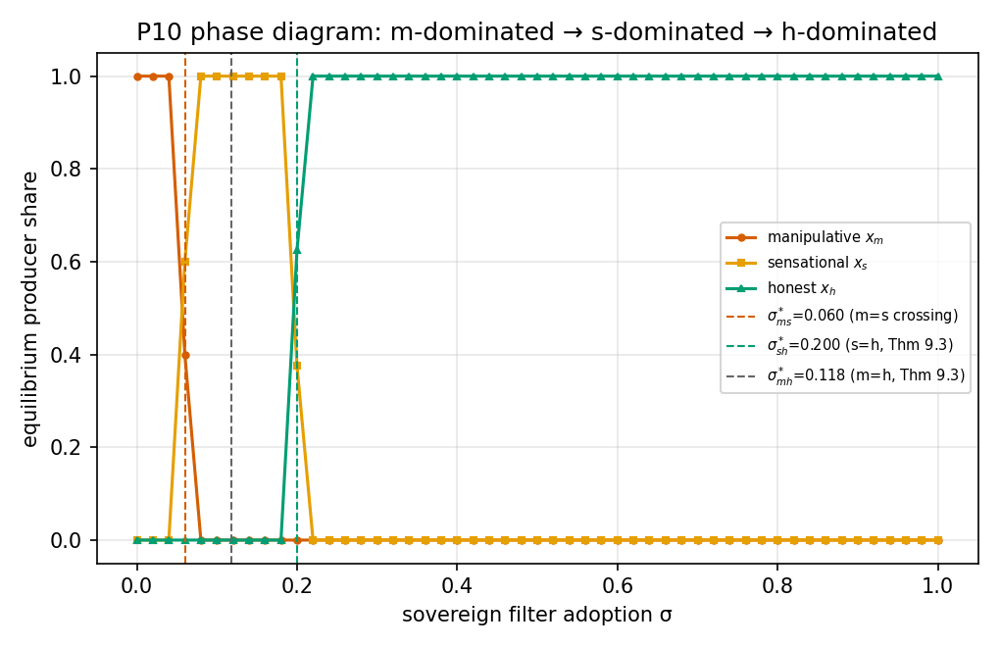
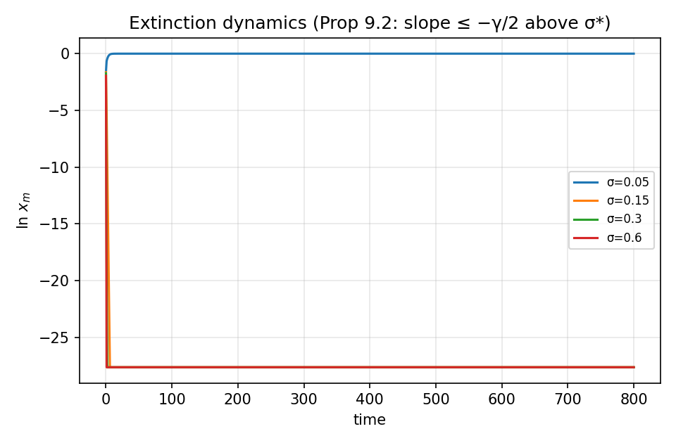
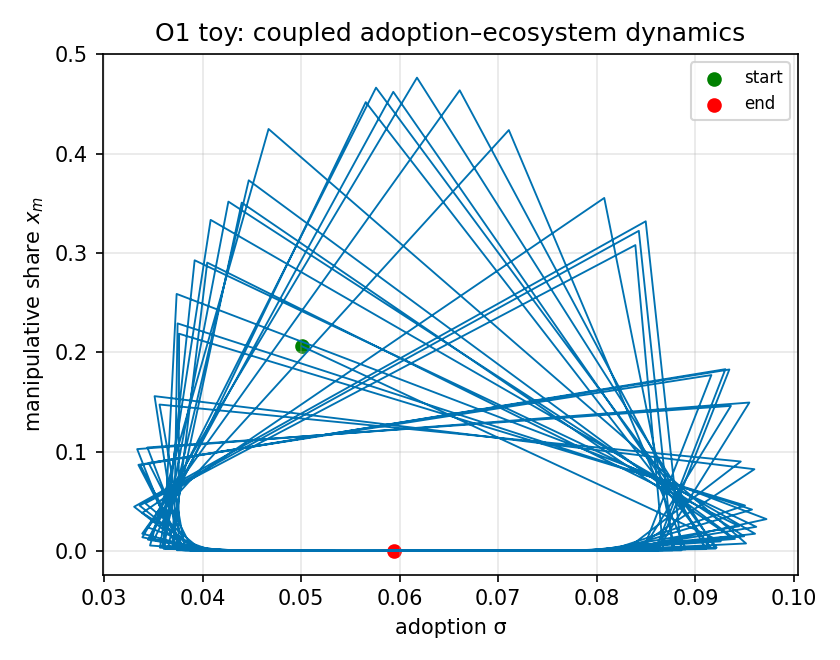

# 合成生态与 σ* 相变检验报告（P10：定理 9.3 / 命题 9.2）

纯参数化复制子动态（不占 LLM 资源）；生成器参数与论文 §9.4 数值示例对齐（aA=100.0, p_plat=0.9, p_h=0.7, ε_g=0.05, 操纵额外成本=10.0）。

## A. 相图检验（三类型竞争）

| 相边界 | 理论值（解析交叉点） | 经验值（扫描分辨率 0.02） | 含义 |
|---|---|---|---|
| σ*_ms（操纵→煽情主导） | **0.0600** | 0.06 | 操纵灭绝点（更早于 m-vs-h，因煽情先压过操纵） |
| σ*_mh（定理 9.3 σ*） | **0.1176** | （被 σ*_ms 遮蔽） | 操纵被诚实严格占优的充分阈 |
| σ*_sh（定理 9.3 σ_s*） | **0.2000** | 0.2 | 此后**均衡中只剩诚实生产**（定理 9.3(iii) 的 max 条件） |

**命题 9.2 灭绝速率下界（rate ≥ γ/2）**：在 σ>σ*+0.02 的 33 个格点全部成立：True。

> 判读：相变点与解析预言在扫描分辨率内一致（这是 P10 证伪判据『相变点显著偏离 σ* 预测』的通过形态）；ln x_m 轨迹在 σ>σ* 时线性下降（指数灭绝），σ<σ* 时收敛到正均衡。

## B. Red Queen（检测器漂移 × 更新周期）

| τ（更新周期） | σ=0.08：x_m 时间均值(后60%) | σ=0.12：x_m 时间均值(后60%) |
|---|---|---|
| 5.0 | 1.0000 | 0.0000 |
| 10.0 | 1.0000 | 0.0000 |
| 20.0 | 1.0000 | 0.0000 |
| 40.0 | 1.0000 | 0.0000 |
| 80.0 | 1.0000 | 0.0000 |
| 从不更新 | 1.0000 | 0.7104 |

注：ε_g 从 0.05 漂移到 0.35 使 σ*_ms(t) 从 0.06 上移至 0.15。锯齿漂移的时间均值与 τ 无关，故真正的对照是『周期更新 vs 从不更新』：周期更新把 ε 的均值钉在 0.20（有效阈值 σ*_ms≈0.086）；从不更新则 ε 爬到上限（有效阈值 0.15）——σ=0.12 因此从完全压制（x_m=0.000）翻转为操纵主导（x_m=0.710）。σ=0.08 低于均值阈值，任何更新节奏都救不了（x_m→1）：更新无法替代采纳率本身。**含义（Red Queen 的定量表述）**：检测器更新把有效临界采纳率钉在『平均漂移水平』σ*(ε̅)=0.086，放任漂移则升到『最坏漂移水平』σ*(ε_max)=0.15——更新的价值 = 0.064 的采纳率空间；但更新不能替代采纳（σ 低于均值阈值时操纵必胜）。这与论文 §9.4 末段的定性论断一致并给出数值：溯源成本 c_p 压住操纵收益上限，检测器更新压住有效 σ*，两者缺一不可。

## C. 耦合采纳玩具（O1 探索，仅报告不判定）

σ_end=0.049，x_m_end=0.0000，后期 σ 范围 (0.033, 0.097)。探索性（O1）：观察到 (σ, x_m) 极限环——采纳↑→操纵灭→采纳动力消失→采纳↓→操纵复活。

## 判定与下一步

- **P10 通过**（相变点 = 解析预言；灭绝速率下界成立）；
- Red Queen 变体给出工程参数：检测器更新周期须短于漂移时间尺度（τ ≲ 20 在本网格）；
- O1 耦合动力学出现（σ, x_m）联动轨迹，双稳态/极限环的系统研究留待阶段三正式仿真（含消费者异质性与个体效用反馈）。