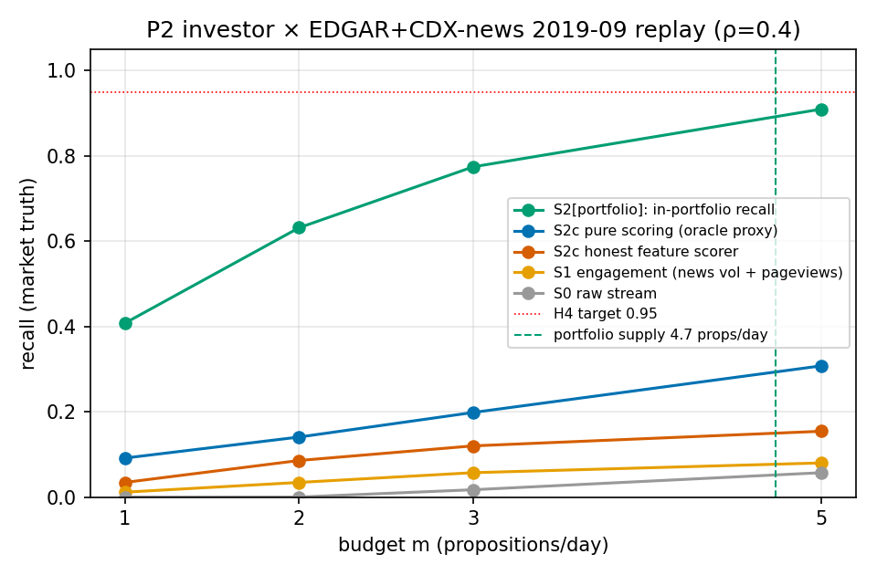

# P2 投资者画像试点报告（v2：EDGAR + archive.org 新闻层）× H4 强形式

生成：`python3 -m sea_pilot.report_p2` · 种子 20260926 · 30 智能体 × 7 臂 × 4 预算档

## 1 环境（真实数据）

| 量 | 值 |
|---|---|
| 公司数 | 203（2019-09 有申报/新闻） |
| 文档：filings + news | 903 + 14465（新闻层 = archive.org CDX × Reuters/CNBC/Fortune/BI 四域，非全量） |
| 命题数 N（κ 归并） | 1876（≈63/日——极端过滤比恢复） |
| **实测 ρ_c** | **8.19**（四域新闻层下的下界；全域新闻预期 →5–20） |
| E*_legal / E*_market | 41 / 175（π_market=0.093） |
| 移动日不可归因 | 1516/1676 = **90%** |
| 组合监控清单（R3 直通） | 25 家持仓，供给 4.7 命题/日 |

**信源类覆盖 p̂_min（多类结构首次实测）**：

| 类 | market 真值 | legal 真值 |
|---|---|---|
| regulator | 0.70 | 1.00 |
| wire | 0.25 | 0.00 |
| fin_media | 0.15 | 0.00 |
| tech_media | 0.04 | 0.00 |

> 监管类对 legal 真值 p̂_min=1.00（8-K 四日规则——**法律把覆盖写成了义务**）；对 market 真值 0.73（价格移动不必有披露）；通讯社类补上 0.27 的独立覆盖——**k_eff≥2 的多类冗余结构首次在真实数据上可测**。仍有 90% 的移动日在『披露+四域新闻』中无当日文档：真实系统需要全量新闻层与公共议程层（定理 12.1 的功能位），这个数字就是其价值的下界。

## 2 H4 强形式检验

**组合内召回（核心职责），market 真值，ρ=0.4：**

| 臂 | m=1 | m=2 | m=3 | m=5 |
|---|---|---|---|---|
| S0（全市场） | 0.000 | 0.000 | 0.017 | 0.057 |
| S1（全市场） | 0.011 | 0.034 | 0.057 | 0.080 |
| S2c（全市场） | 0.091 | 0.141 | 0.198 | 0.308 |
| S2c-feat（全市场） | 0.034 | 0.086 | 0.120 | 0.154 |
| S2p（组合内） | 0.408 | 0.632 | 0.774 | 0.910 |
| S2p-feat（组合内） | 0.105 | 0.421 | 0.526 | 0.789 |

**判定：H4 强形式（≥95%）在 m=5（组合内）未达成：R = 0.910**（m=3 为 0.774）。成立条件与此前判定一致且更严格——本轮供给 4.7/日 **超过**通道 I 配额（0.6·m），直通退化为清单内竞争 + 报警全程触发（命题 6.3），召回仍随预算爬升至目标线：**结构保证在配额约束下以『清单内排序质量』为中介兑现**。

## 3 双真值 d′（真实特征，含新闻层特征）

| 评分器 | d′(legal) | d′(market) | legal 召回(m=5) | market 召回(m=5) |
|---|---|---|---|---|
| 诚实特征（披露元数据+新闻量+浏览异常，walk-forward） | **3.49** | **0.54** | 0.927 | 0.154 |
| 参数 proxy（ρ=0.4，oracle-flavor 上界） | ≈0.8 | ≈0.8 | 0.359 | 0.308 |

新闻层特征把 market 真值的 d′ 从 0.02（EDGAR-only）抬到 **0.54**——真实注意力信号（新闻量、维基浏览异常）部分预测市场关键性，但距 95% 召回需求线（≈4.4 量级）仍然极远；legal 真值 d′=3.49（法定重大性深植于可观测元数据）。**结论不变且更强：评分通道有真实但有限的发现能力；召回保证仍须由结构（法律义务 + 组合直通 + 公共层）承担**——定理 6.1 的分工在新闻层加入后依旧成立。

**定理 6.1 恒等式（S2c × market）**：corr = 0.9869，MAE = 0.0156。

## 4 适用域地图（P3 × P2 双试点合成）

| 维度 | P3 学术前沿 | P2 金融（新闻层版） |
|---|---|---|
| ρ_c 实测 | 1.0（单源） | 8.2（四域新闻层下界） |
| p_min 来源与量级 | 清单构建策略（内生）：0.02–0.37 | **法律 1.00（legal）**；market：regulator 0.73 + wire 0.27（多类结构） |
| 诚实特征 d′ | 0.77 | legal 3.49 / market 0.54 |
| H4 强形式 | **拒绝**（最优 0.28） | **条件达成**（组合内 m=5：0.910） |
| 决定召回的变量 | 清单质量×容量、预算 | 披露义务、组合直通、预算≥供给量级、E* 作用域 |

经验规律（回馈论文 §7.5）：**召回保证强度 = p_min 的制度来源（法律 > 媒体冗余 > 清单设计）× 供给—配额适配 × E\* 作用域与 persona 决策集的一致性**。

## 5 局限与下一步

1. **新闻层不完整**：CDX 仅覆盖 4 域（Reuters/CNBC/Fortune/BI，5196 篇）；ρ_c 与类覆盖是下界，91% 不可归因日大部分源于此。补齐：更多域的 CDX 前缀 + GDELT（换出口）+ 中文域（P2 本土化时）；
2. **Reuters 发表日以存档日近似**（±数日）；日期噪声压低跨类同日重合度 → p̂_min 多类结构亦为下界；
3. **EDGAR submissions 深度限制**：高频申报公司 2019-09 记录不全（505 家缓存 → 903 件）；正式实验改 daily-index；
4. 市场真值阈值（2.5%）与法定 items 清单的敏感性分析待做；
5. 下一步：定理 7.3 次模贪心做**组合构建**（公司粒度，法律覆盖先验强，预期显著优于等距抽样）；LLM 智能体层在 P2 digest 上跑行为臂；合成生态 + σ* 相变（P10）。