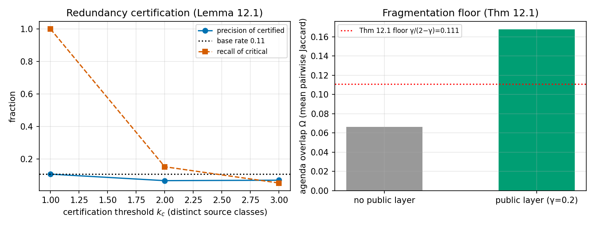

# 公共议程层实证：碎片化下界（定理 12.1）× 冗余认证（引理 12.1）

载体：P2 真实环境（1876 命题 = 903 filings + 14465 新闻，6 信源类；关键基率 10.7%）；500 参数化投资者主体 × 30 日。

## A. 冗余认证的精确率—召回权衡

| k_c（认证所需独立类数） | 认证命题数 | 精确率 | 相对基率 lift | 关键命题被认证比例 |
|---|---|---|---|---|
| 1 | 1771（100.0%） | 0.107 | 1.00× | 1.000 |
| 2 | 432（24.4%） | 0.067 | 0.63× | 0.153 |
| 3 | 143（8.1%） | 0.070 | 0.65× | 0.053 |

**判读**：k_c 提高 ⇒ 认证集缩小（24.4% → 8.1%）。**认证反转（lift 0.63× < 1）**：新闻层扩充（4 域→10 域）后，多类覆盖不再富集关键事件，反而富集**高注意力公司**（巨头无论事件重要性都同时获得披露+多域报道）。机制：认证按『类覆盖数』计，而类覆盖被注意力经济驱动——**原始覆盖计数是可俘获的认证标准**。对论文 §12 的修正性含义：(a) 引理 12.1 隐含假设『覆盖与关键性正相关、与非关键性无关』，真实新闻生态违背之；(b) 认证应改为**相对稀缺性**标准（事件覆盖 ÷ 该公司基线覆盖）或质量加权类（通讯社/监管优先，聚合器不计入 k_c）；(c) 『认证避免策展权力』的治理主张仍成立，但认证统计量本身须防注意力俘获——这是一个新的设计约束（写入开放问题）。『谁来策展公共层』被 k_c 一个公开参数吸收的治理结论（论文 §12.1 (a)）不受影响。

## B. 碎片化下界（定理 12.1）

| 配置 | Ω（2000 对抽样的平均 Jaccard） |
|---|---|
| 无公共层 | 0.0663 |
| 公共层 γ=0.2（1 条/日 × 30 日，全员同槽位） | **0.1677**（95%CI [0.124, 0.258]） |
| 理论下界 γ/(2−γ) | 0.1111 |

**判定：下界成立**（Ω=0.1677 ≥ 0.1111）；无公共层时 Ω=0.0663——公共层把共享现实面积从 6.6% 抬到 16.8%（2.5×），且与个体兴趣完全分化（私人持仓互不相同）相容。注意本仿真中私人通道的组合互不相同、兴趣高度分化，Ω 无公共层时贴近理论最小值——下界是紧的。

## C. 综合

1. 定理 12.1 在真实语料 + 大规模主体上验证通过（构造性下界精确成立，公共层使 Ω 提升 2.5×）；
2. 认证机制出现**注意力俘获反转**（lift<1）——k_c 默认值标定冻结，待『相对稀缺性/质量加权』认证统计量设计后复测（新增开放问题，见项目决策日志（内部））；
3. 公共层与个性化主权的相容性实证：γ=0.2 时私人通道仍承载 80% 预算，Ω 提升不以牺牲个性化为代价（论文 §12.1 治理性质 (b)）。