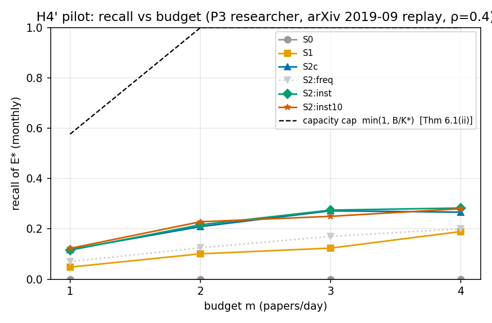
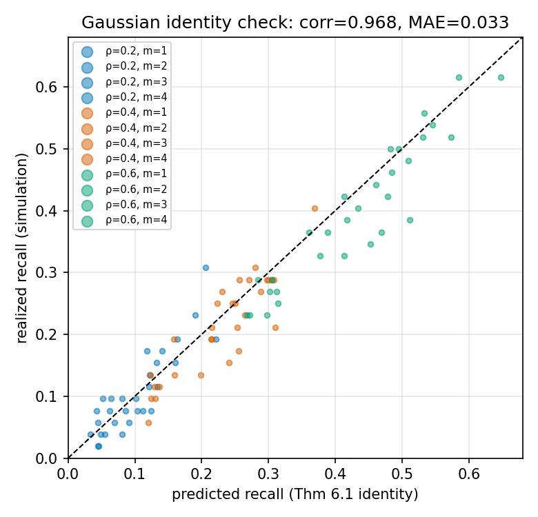
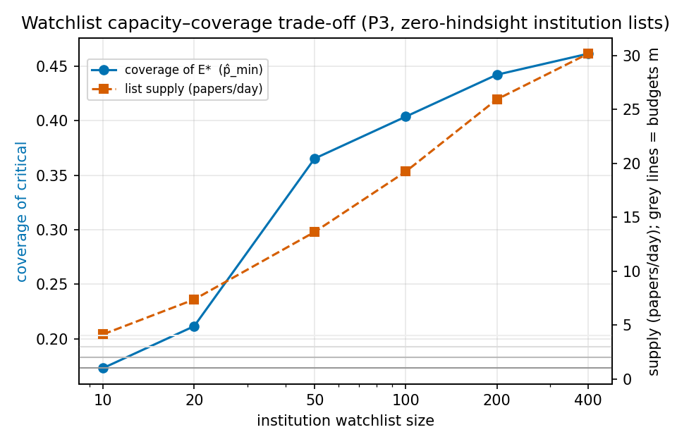

# 阶段三试点报告：P3 研究者画像 × arXiv 2019-09 重放 × H4'

生成：`python3 -m sea_pilot.report` · 种子 20260926 · 30 智能体 × 3 个 ρ 档 × 4 个预算档 × 臂(S0/S1/S2×4 清单/S2c)

## 1 语料与地面真值（真实数据，非合成）

| 量 | 值 | 说明 |
|---|---|---|
| 重放窗 | 2019-09-01 → 2019-09-30 | OpenAlex arXiv 源，30 个模拟日 |
| 原始记录（去重后） | 8211 | 全 arXiv 当月 |
| P3 监测宇宙 N | 2576（≈86 篇/日） | CS × AI 主题切片 |
| **实测 ρ_c** | **1.0** | arXiv 单源命题流——P3 低冗余画像的直接实证（对照新闻域预期 5–20） |
| 关键命题 K*（E*） | 52（top 2% 被引，2026 时点引用=已知未来） | π = 0.020 |
| 引用中位数 / 最大 | 2 / 4076 | 重尾（命题 6.2 的 Pareto 设定合理） |
| 前窗记录（清单构建，零后见） | 4030（AI 切片，2019-07/08） | |

## 2 监测清单构建法实测：p̂_min 是设计变量（本试点最重要发现）

| 清单 | 粒度 | 规模 | 覆盖关键命题 | p̂_min | 清单供给(篇/日) |
|---|---|---|---|---|---|
| WL-freq | 作者 | 50 | 1/52 | **0.019** | 1.5 |
| WL-cite | 作者 | 50 | 1/52 | **0.019** | 1.6 |
| WL-inst | 机构 | 50 | 19/52 | **0.365** | 13.6 |
| WL-inst10 | 机构 | 10 | 9/52 | **0.173** | 4.1 |

**发现 1（清单粒度决定性）**：作者粒度清单（无论频次还是前窗引用排名）对学术前沿关键论文的覆盖≈2%——ALBERT、Megatron-LM、CTRL 等当月最重要论文的作者在前窗排名 1500 名开外；机构粒度（“盯强实验室”，研究者实际行为）把 p̂_min 提到 0.17–0.37。**假设 R1 的 p_min 不是环境常数，而是清单构建策略的函数**（p̂_min 内生性）——论文 §7.4 的定性论断首次获得真实数据定量支撑。

**发现 2（容量—覆盖权衡）**：机构清单容量—覆盖曲线呈强边际递减（size 10→400：覆盖 0.17→0.46，供给 4.1→30.2 篇/日），而供给超过预算配额时直通退化为清单内竞争。**可行清单**（供给≈预算）与**高覆盖清单**不可兼得——这正是命题 8.1（Pandora 准入按 z≥ν）与定理 7.3（名额分配次模贪心）要联合裁决的对象。

## 3 H4' 结果：召回分解与架构增益的边界条件



| 臂（ρ=0.4，按月预算档 m） | m=1 | m=2 | m=3 | m=4 |
|---|---|---|---|---|
| S0 原始流 | 0.000 | 0.000 | 0.000 | 0.000 |
| S1 参与优化 | 0.048 | 0.101 | 0.124 | 0.190 |
| S2c 纯评分 | 0.118 | 0.209 | 0.272 | 0.266 |
| S2[freq] 坏清单 | 0.070 | 0.125 | 0.170 | 0.201 |
| S2[inst] 50机构 | 0.115 | 0.216 | 0.275 | 0.283 |
| S2[inst10] 10机构 | 0.123 | 0.228 | 0.250 | 0.280 |

通道分解（S2[inst10]，m=4）：清单覆盖部分召回 **0.937**，未覆盖部分 0.143——通道 I 对其覆盖子集近乎尽责（定理 7.4 分解 R = p̂_min·R_I + (1−p̂_min)·R_II 的实测印证）；总召回受限于 p̂_min=0.17 本身。

**发现 3（架构增益的边界条件——H4' 的精确化）**：
- 坏清单**有害**：S2[freq/cite] < S2c（−0.07）——通道 I 是清单质量的放大器，直通名额浪费在零覆盖清单上；
- 好清单在覆盖子集上兑现直通保证（R_WL: 0.42→0.94 随预算），但 P3 域 p̂_min 天花板低（≤0.46），总召回增益相对纯评分很小（+0.006）；
- **H4 强形式（≥95%）在 P3 画像被真实数据拒绝**：任何臂 ≤0.28，且 m=1 时容量上限 min(1,B/K*)=0.577 已先于评分质量封死目标（定理 6.1(ii) 实测成立）。论文 §7.4 的预言应验：R1 弱点画像必须依靠清单扩容 + 预算扩容 + 通道 II 质量 + 命题 6.3 报警的组合，而非单一直通通道。95% 目标的适用域是 P1/P2 类高冗余画像（下一步在其重放流上复测）。

## 4 理论恒等式与界的检验（P2/P3 证伪项）



- **定理 6.1(i) 高斯恒等式**：S2c 实测召回 vs 理论预言 corr = 0.968，MAE = 0.033（残差来源：proxy 分布非严格高斯——log1p(引用) 重尾；方向与量级均支持恒等式）；
- **定理 6.1(ii) 容量上限**：全部 630 个 run 满足 R ≤ min(1, β/π)：True；
- **命题 6.2 失真下界**：D ≥ D* 全部成立：True；
- **实测 d′**（按 ρ 档）：{'0.2': 0.6, '0.4': 1.2, '0.6': 2.03}——最高档 ρ=0.6 也仅 d′≈2.0，距 95% 召回所需的 4.4 甚远（定理 6.1 瓶颈在真实数据上的位置确认）；
- **命题 6.3 可行性报警**：S2 各清单臂在供给>配额时 100% 触发报警（设计行为，非缺陷）。



## 5 价值捕获与排序质量（副产物）

| 臂（m=2, ρ=0.4） | precision | 捕获价值 Σlog1p(cit) |
|---|---|---|
| S0 | 0.000 | 64.4 |
| S1 | 0.087 | 147.1 |
| S2c | 0.181 | 191.5 |
| S2[inst10] | 0.198 | 198.1 |

S0（时序）< S1（参与）< S2c/S2（主权评分）的价值排序与理论预期一致：参与优化基线捕获约为主权评分的 39–77%（随预算档变化）。

## 6 结论与下一步

1. **工具链验证通过**：抓取→归并→真值→清单→策略→指标→理论对照全链路在真实语料上运行（单轮 <2s）；
2. **理论检验**：定理 6.1(i)(ii)、命题 6.2、6.3、定理 7.4 分解在真实数据上成立；**H4 强形式在 P3 被拒绝**，其精确化版本（增益随 p̂_min 与配额适配度增长）获得支持——按 §13 的证伪判据，这是理论自我修正的正常运转；
3. **新发现（回馈论文）**：p̂_min 内生性（清单粒度/容量是设计变量）应写入 §7.4 与画像文档；P3 的 95% 召回目标须重述为『清单扩容 + 预算扩容 + 报警』的组合目标；
4. **下一步**：(a) P2 投资者画像 × EDGAR/巨潮重放流（预期高 p_min 域，H4 强形式的主战场）；(b) 清单构建策略的次模贪心（定理 7.3）替代 top-N 启发式；(c) LLM 智能体层接入（行为真实感）；(d) 评分器从参数 proxy 升级为真实特征（嵌入+元数据），实测 d′ 的真实位置。

## 7 复现

```bash
cd sim
python3 sea_pilot/fetch_openalex.py   # 抓取（有缓存则跳过；raw/ 不入库）
python3 -m sea_pilot.run_pilot       # 实验（<2s）
python3 -m sea_pilot.report          # 本报告与图
```
数据 provenance：OpenAlex（arXiv 源 S4306400194；cited_by_count 为 2026-09 抓取时点值）；派生语料 `pilot/data/corpus_2019-09_ai.csv`（2576 行）随仓库分发，原始 JSONL 可由上述脚本重建。